

  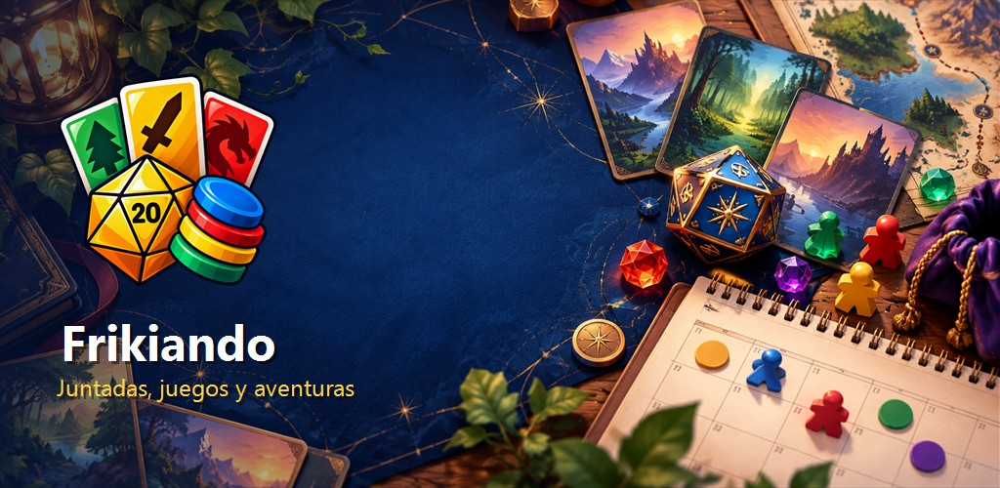

  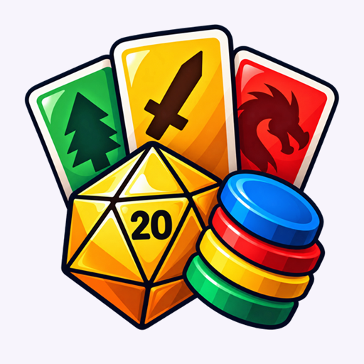

<h1 align="center">Frikiando</h1>

  <strong>Less coordination. More time to play.</strong> 
  Android product for organizing board game meetups, private groups and tabletop RPG adventures.

  
  
  
  
  

> This is a public product showcase. The production source code, infrastructure configuration and credentials are kept in a separate private repository.

## Product overview

Frikiando turns the conversations that happen before a game night into a clear, collaborative plan. Friends can bring their personal board game libraries together, coordinate attendance, compare proposals, build a realistic schedule and know exactly what each person needs to bring.

The same product also supports persistent tabletop RPG characters and adventures, allowing a group to continue a campaign across multiple real-world sessions without mixing up dates, locations or session history.

## The problem

Organizing a game night usually spreads information across chat messages, personal game collections, polls and memory. The group needs to answer several connected questions:

- Who is attending?
- Which games are actually available?
- Who owns each game?
- How much time is needed for setup and rules explanation?
- What should each participant bring?
- Is this a new RPG adventure or the continuation of an existing one?

Frikiando brings those decisions into one shared flow while keeping each community private.

## Main capabilities

### Personal game library

- Register and manage a personal board game collection.
- Add cover art, player range, duration, difficulty and setup time.
- Search, filter and inspect game details.
- Preserve ownership when libraries are combined inside a group.

### Private groups

- Create private communities or join them using an invitation code.
- See members and the combined set of available games.
- Use a private group chat with notifications and unread indicators.
- Report or block users and manage group ownership safely.

### Collaborative meetups

- Create meetups with date, time, location and attendance responses.
- Add existing group members to an already-created meetup.
- Compare proposals and vote on dates, food and schedules.
- Build timelines using games and manual activities.
- Include setup time and first-play explanation time automatically.
- Assign responsibilities and show each participant what they must bring.
- Close planning with a warning instead of blocking on unanswered invitations.

### Role-playing characters and adventures

- Create manual or guided RPG characters.
- Track attributes, resources, inventory and spells.
- Assign and select characters for an adventure.
- Record sessions, rests and participant state.
- Continue a previous adventure while creating new meetup logistics.

### Account and privacy

- Email and password authentication.
- Profile preferences and configurable notifications.
- Privacy policy, terms and community rules available inside the app.
- Account and associated-data deletion flow.
- Crash reporting enabled only for release builds, without advertising analytics.

## Product gallery

<table>
  <tr>
    <td align="center">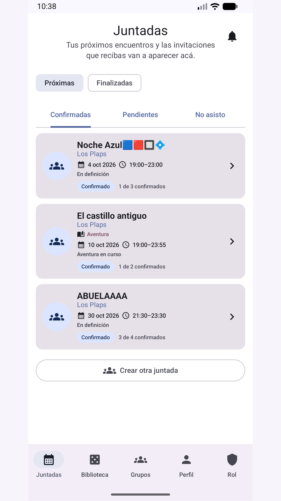 <strong>Gatherings</strong></td>
    <td align="center">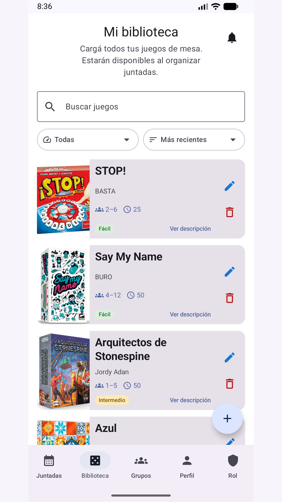 <strong>Personal library</strong></td>
  </tr>
  <tr>
    <td align="center">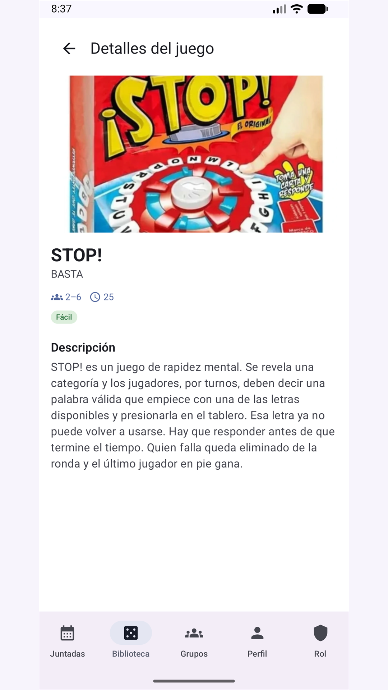 <strong>Game details</strong></td>
    <td align="center">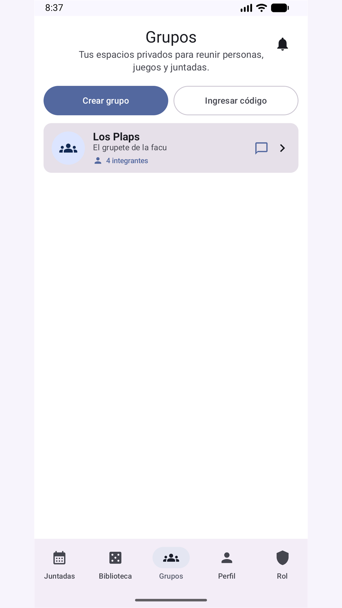 <strong>Private groups</strong></td>
  </tr>
  <tr>
    <td align="center">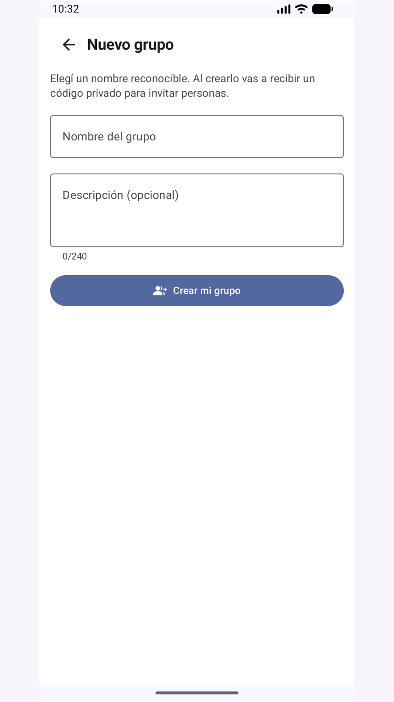 <strong>Create a group</strong></td>
    <td align="center">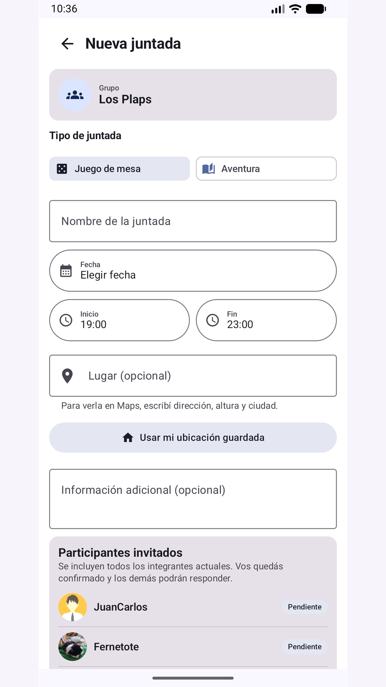 <strong>Create a gathering</strong></td>
  </tr>
  <tr>
    <td align="center">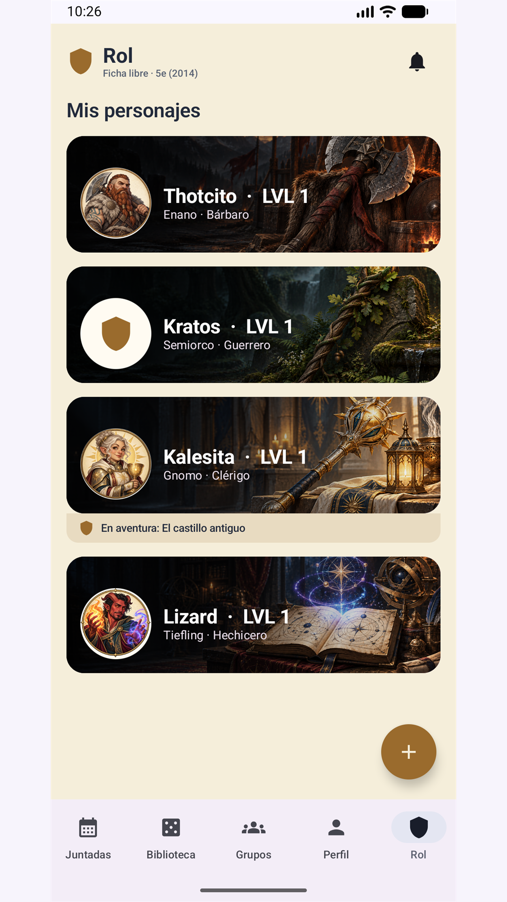 <strong>RPG characters</strong></td>
    <td align="center">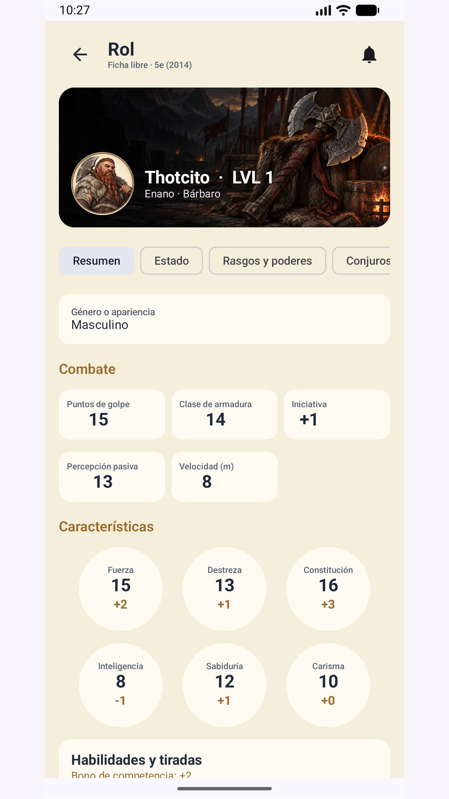 <strong>Character sheet</strong></td>
  </tr>
  <tr>
    <td align="center">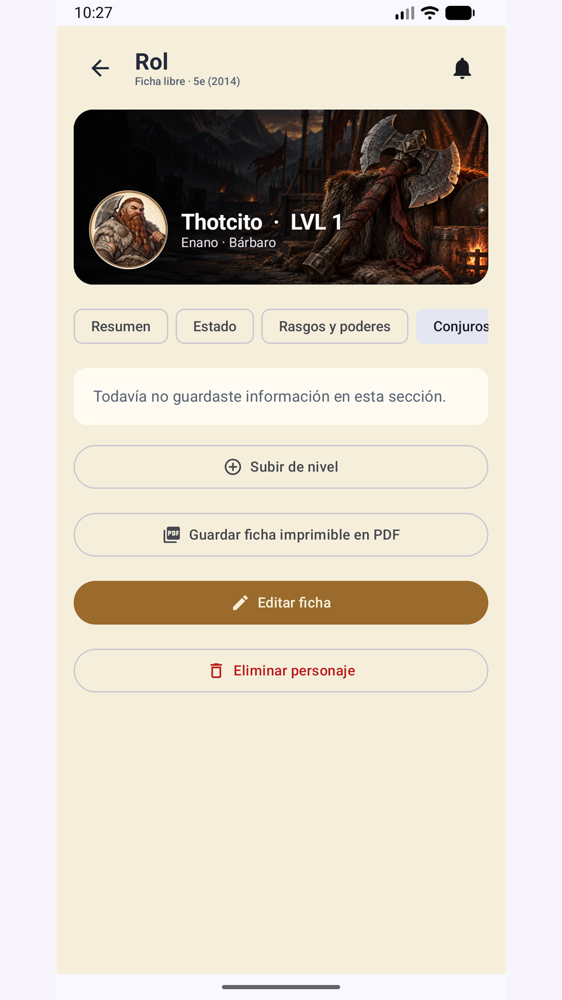 <strong>Spells and resources</strong></td>
    <td align="center">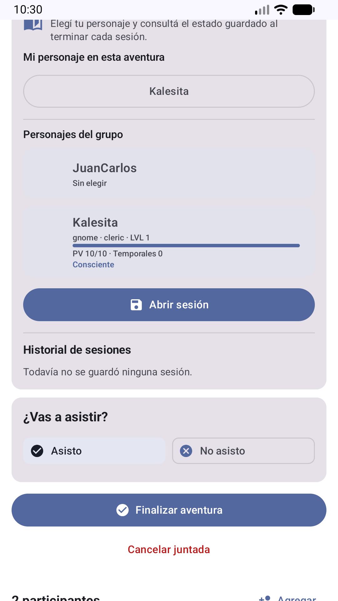 <strong>Adventure continuity</strong></td>
  </tr>
</table>

## Core product flow

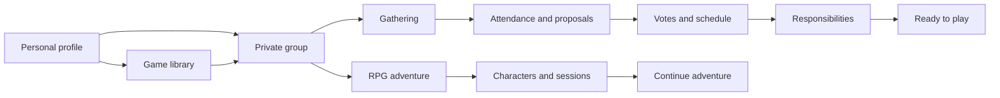

## High-level architecture

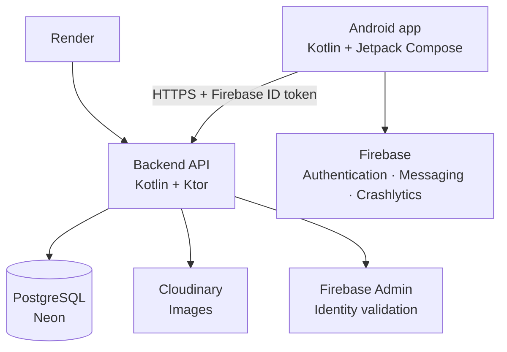

The mobile client never receives database credentials or server secrets. Authentication starts in Firebase, while the API validates identity and authorization before accessing group or personal information.

## Technology stack

| Area | Technology |
| --- | --- |
| Android | Kotlin, Jetpack Compose, Material 3 |
| Architecture | Unidirectional UI state, repositories and authenticated API flows |
| Backend | Kotlin/JVM, Ktor and Netty |
| Database | PostgreSQL on Neon with versioned Flyway migrations |
| Authentication | Firebase Authentication and Firebase Admin |
| Notifications | Firebase Cloud Messaging and an in-app notification center |
| Diagnostics | Firebase Crashlytics in release builds |
| Images | Cloudinary |
| Deployment | Docker on Render |
| Quality | Unit tests, integration tests, Android lint, R8 and GitHub Actions |

## Selected product and engineering decisions

- **Private by default:** groups, chats, meetups and combined libraries are visible only to their members.
- **Personal ownership first:** a game belongs to a personal library even when it becomes available to a group.
- **Realistic scheduling:** game duration is not enough; setup and explanation time are part of the plan.
- **Explicit adventure continuity:** continuing a campaign is a deliberate action, preventing unrelated sessions from being mixed.
- **Event-driven refresh:** participant changes update from meaningful actions instead of constant polling.
- **Idempotent interactions:** repeated attendance selections and votes avoid unnecessary requests.
- **Privacy-aware diagnostics:** Crashlytics is restricted to published builds and no advertising analytics SDK is included.
- **Free-tier resilience:** the interface explains possible cold-start delays while the backend wakes up.

## Quality and delivery

- Versioned database evolution through 33 migrations.
- Real integration checks against Firebase, the API and the development database.
- Automated backend and Android verification before publishing changes.
- Release optimization with R8 and resource shrinking.
- Controlled Crashlytics connection test completed successfully.
- Version 1.2 distributed through Google Play closed testing.

## Current status

Frikiando **1.2** is being tested by selected users through Google Play Closed Alpha. Feedback from real devices is used to prioritize the next iteration before a broader release.

## Resumen en español

Frikiando es una aplicación Android para organizar juntadas de juegos de mesa y aventuras de rol. Cada persona administra su biblioteca, participa en grupos privados, confirma asistencia, propone y vota alternativas, crea cronogramas realistas y consulta qué debe llevar.

El producto se encuentra en una prueba cerrada de Google Play. Este repositorio muestra su alcance, experiencia, arquitectura y decisiones principales; el código fuente de producción permanece privado.

## Public information

- [Privacy policy](https://zorapp-frikiando-api.onrender.com/privacidad)
- [Account deletion](https://zorapp-frikiando-api.onrender.com/eliminar-cuenta)
- [Terms and community rules](https://zorapp-frikiando-api.onrender.com/terminos)
- [Legal notices](https://zorapp-frikiando-api.onrender.com/avisos-legales)

## Repository scope

This repository intentionally contains only portfolio documentation and approved product imagery. It does **not** contain application source code, signing material, credentials, private configuration, database exports or production logs.

## Contact

Developed by **Gonzalo D. Lopez / ZorApp** 
Contact: [zorapp.dev@gmail.com](mailto:zorapp.dev@gmail.com)

---

© 2026 Gonzalo D. Lopez / ZorApp. All rights reserved. Product names, visual identity and media may not be reused without permission.
